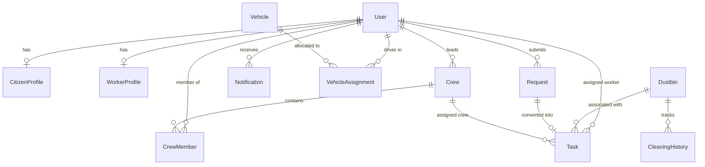

# Smart Waste Management System (SWMS)

A comprehensive, role-aware municipal waste management platform built with **Django** and **PostgreSQL**. The system provides end-to-end municipal waste handling across three primary user roles: **Citizen**, **Administrator**, and **Worker**.

Features include unified waste complaints and scheduled household pickups, interactive Google Maps location selection, one-shot citizen nearby dustbin discovery, temporary crew formation with persistent historical archives, vehicle/driver allocation, task lifecycle tracking with proof-of-work photo uploads, and in-app notifications.

---

## Table of Contents

- [Key Features](#key-features)
- [Primary User Roles](#primary-user-roles)
- [Application Architecture](#application-architecture)
- [Database Models and Relationships](#database-models-and-relationships)
- [Core Workflows](#core-workflows)
  - [1. Citizen Request Lifecycle](#1-citizen-request-lifecycle)
  - [2. Interactive Map-Based Task Creation](#2-interactive-map-based-task-creation)
  - [3. Public Dustbin Registration and Tracking](#3-public-dustbin-registration-and-tracking)
  - [4. Citizen Nearby Dustbins Locator](#4-citizen-nearby-dustbins-locator)
  - [5. Crew Formation, Dissolution, and Historical Archives](#5-crew-formation-dissolution-and-historical-archives)
  - [6. Vehicle and Driver Allocation](#6-vehicle-and-driver-allocation)
  - [7. Worker Task Execution and Admin Verification](#7-worker-task-execution-and-admin-verification)
- [Complete URL Routing Reference](#complete-url-routing-reference)
- [Google Maps Integration](#google-maps-integration)
- [Environment Configuration](#environment-configuration)
- [Installation and Setup](#installation-and-setup)
- [Automated Tests and Verification](#automated-tests-and-verification)
- [Project Directory Layout](#project-directory-layout)

---

## Key Features

- **Three Dedicated Role Dashboards**: Tailored interfaces for Citizens, Administrators, and Workers with role-based view decorators (`@citizen_required`, `@administrator_required`, `@worker_required`).
- **Unified Request System**: Citizens report waste issues (overflowing bins, illegal dumping, damaged bins, roadside waste) or schedule household pickups (household, recyclable, garden, bulky waste) in one unified interface.
- **Interactive Map Pinning**: Administrators can click anywhere on Google Maps or drag pins to pinpoint coordinates when creating tasks or registering dustbins, with automatic two-way input synchronization.
- **Nearby Dustbins Discovery**: Citizens can locate active public dustbins nearby using browser Geolocation API (one-shot detection with zero continuous tracking), displaying real-time distance calculations, cleaning status, and manual map navigation fallback.
- **Dynamic Crew Operations**: Administrators assemble temporary operational crews from active workers and assign a designated crew leader. Historical membership and task records are permanently retained even after crew dissolution.
- **Fleet and Driver Allocation**: Municipal vehicles (compactors, mini tippers, trucks) are tracked for availability and assigned to approved drivers with complete assignment history.
- **Proof-of-Work Verification**: Workers mark tasks "In Progress" and "Completed" by submitting completion remarks and photo evidence. Administrators review submissions and verify completion.
- **In-App Notification Center**: Keeps users informed of task assignments, request approvals, and status transitions.

---

## Primary User Roles

| Role | Access Level | Core Responsibilities & Capabilities |
| :--- | :--- | :--- |
| **Citizen** | Self-registered, auto-activated | • Submit complaints and schedule household waste pickups with photos and coordinates.<br>• Track request status and review admin remarks.<br>• Locate nearby public dustbins on Google Maps with distance estimates.<br>• Cancel submitted requests prior to assignment. |
| **Administrator** | Pre-provisioned / Superuser | • Comprehensive operations dashboard with municipal statistics.<br>• Review, approve, reject, and convert citizen requests into tasks.<br>• Create and dispatch tasks using interactive map coordinate pickers.<br>• Register and track public dustbins and review cleaning history.<br>• Review, approve, and manage worker profiles and worker IDs.<br>• Assemble temporary crews, assign crew leaders, and inspect historical archives.<br>• Manage fleet inventory and assign drivers to vehicles.<br>• Inspect worker completion photos and verify completed tasks. |
| **Worker** | Registered, requires Admin approval | • Designations: **Sanitation Worker / Cleaner** or **Driver**.<br>• Toggle daily operational availability (`Active` / `Inactive`).<br>• View assigned individual tasks or tasks assigned to their active crew.<br>• Start tasks, navigate to locations, and complete tasks with photo uploads and remarks. |

---

## Application Architecture

The system is structured into three cohesive Django apps:

```
SmartWasteManagementSystem/
├── accounts/          Authentication, user model, role profiles, approvals, OTP reset
├── citizen_services/  Dustbins, cleaning history, unified citizen requests, locator API
├── workforce/         Vehicles, fleet assignments, crews, tasks, notifications, operations
├── config/            Project settings, root URL routing, context processors
├── templates/         Django templates styled with responsive modern CSS
└── static/            Stylesheets, brand assets, and client-side map scripts
```

- **`accounts`**: Owns the custom `User` model, email-based authentication (`EmailBackend`), `CitizenProfile`, `WorkerProfile`, and single-use `PasswordResetOTP`.
- **`citizen_services`**: Manages municipal assets (`Dustbin`, `CleaningHistory`) and citizen service records (`Request`), along with the public dustbins JSON API.
- **`workforce`**: Handles operations (`Vehicle`, `VehicleAssignment`, `Crew`, `CrewMember`, `Task`, `Notification`), workforce availability, and task execution workflows.
- **`config`**: Holds project configuration, PostgreSQL database setup, Google Maps settings, and root URL routing.

---

## Database Models and Relationships



### Model Summary

| Model | App | Purpose |
| :--- | :--- | :--- |
| **`User`** | `accounts` | Custom user model extending `AbstractUser`. Enforces unique email login, role (`citizen`, `administrator`, `worker`), and admin approval status (`approved`, `rejected`). |
| **`CitizenProfile`** | `accounts` | Stores citizen address details: house number, street locality, ward number, and village name. |
| **`WorkerProfile`** | `accounts` | Stores worker ID, designation (`driver`, `cleaner`, `crew_leader`), date of birth, gender, address, experience, ID proof document, and availability (`INACTIVE`, `ACTIVE`, `ASSIGNED`). |
| **`PasswordResetOTP`** | `accounts` | Secure SHA-256 hashed 6-digit one-time passwords for password recovery with attempt counts and 15-minute expiration. |
| **`Dustbin`** | `citizen_services` | Public waste bin asset with automatic code generation (`DBno1`, `DBno2`), coordinates, active state, and last cleaned timestamp. |
| **`CleaningHistory`** | `citizen_services` | Immutable audit log of dustbin cleanings linked to completed tasks, workers, timestamps, and remarks. |
| **`Request`** | `citizen_services` | Unified citizen service record covering both complaints (overflowing bins, illegal dumping, damaged bins, roadside waste) and scheduled pickups (household, recyclable, garden, bulky waste). |
| **`Vehicle`** | `workforce` | Municipal fleet inventory with registration number, vehicle type, and availability flag. |
| **`VehicleAssignment`** | `workforce` | Tracks active and released driver-to-vehicle pairings with assignment and release timestamps. |
| **`Crew`** | `workforce` | Temporary operational team with name, creator, crew leader, active status, formed date, and dissolution date. |
| **`CrewMember`** | `workforce` | Membership record connecting a worker to a crew, retaining role, join date, release date, and status even after crew dissolution. |
| **`Task`** | `workforce` | Operational unit of work with category, coordinates, address, deadline, status (`PENDING`, `ASSIGNED`, `IN_PROGRESS`, `COMPLETED`, `CANCELLED`), worker/crew assignments, completion proof photo, and admin verification. |
| **`Notification`** | `workforce` | In-app notification with message, direct link, read state, and timestamp. |

---

## Core Workflows

### 1. Citizen Request Lifecycle
1. **Submission**: Citizens submit requests via `/citizen/submit/` by choosing a cause:
   - **Complaints**: Overflowing Dustbin, Illegal Garbage Dumping, Damaged Dustbin, Roadside Garbage, or Other. Includes photo upload and location coordinates.
   - **Scheduled Pickups**: Scheduled Waste Pickup. Requires preferred pickup date, preferred time slot, and waste category.
2. **Review & Conversion**: Administrators view requests under `/operations/admin/requests/` and can approve, reject, or directly convert a request into an operational task.
3. **Status Tracking**: Citizens track progress through an interactive status badge timeline (`SUBMITTED` &rarr; `UNDER_REVIEW` &rarr; `APPROVED` &rarr; `ASSIGNED` &rarr; `IN_PROGRESS` &rarr; `RESOLVED`).

### 2. Interactive Map-Based Task Creation
1. Administrators navigate to `/operations/admin/tasks/` to create a task.
2. The page provides an integrated Google Map (`#task-create-map`). Clicking on the map or dragging the marker updates the latitude and longitude inputs automatically.
3. Manual coordinate entry is also fully supported; typing coordinates automatically updates the map marker and pans to the location.
4. Input bounds (`-90` to `90` for latitude, `-180` to `180` for longitude) are validated on both client and server before saving.
5. Tasks can be dispatched immediately to an individual worker or an active crew.

### 3. Public Dustbin Registration and Tracking
1. Administrators access `/operations/admin/dustbins/` to manage municipal dustbins.
2. The **Add New Dustbin** form includes an interactive map (`#dustbin-picker-map`) showing existing bins as reference markers to avoid overlapping placement.
3. Clicking on the map or dragging the green bin marker populates the coordinates.
4. Dustbins receive an automatic sequential code (e.g., `DBno1`, `DBno2`) if left blank.
5. Cleaning history and coordinate adjustments can be managed via the dustbin edit view.

### 4. Citizen Nearby Dustbins Locator
1. Accessible strictly to authenticated citizens via **Nearby Dustbins** navigation or `/citizen/nearby-dustbins/`.
2. Uses a **single one-shot browser Geolocation call** (`getCurrentPosition`) without continuous tracking.
3. Automatically computes straight-line distance to every active dustbin using the Haversine formula and sorts the nearest bins in a dedicated sidebar.
4. Clicking markers displays the bin ID, location description, last cleaned timestamp, and distance from current location.
5. If location permission is denied, a clear message is displayed and the user can navigate the map manually.

### 5. Crew Formation, Dissolution, and Historical Archives
1. **Formation**: Administrators select available workers and a driver, specify a crew name, and appoint a crew leader under `/operations/admin/crews/`.
2. **Operations**: The crew can be assigned tasks as a cohesive unit. All crew members see crew-assigned tasks on their dashboards.
3. **Dissolution**: When the operational cycle finishes, the administrator dissolves the crew.
4. **Historical Archive Preservation**:
   - Dissolution marks `is_active=False` and records `dissolved_at`.
   - **Member associations are permanently preserved** (`CrewMember` rows are kept with `is_active=False`).
   - The **Historical Crew Records** table allows administrators to click **Details** at any time to review full crew composition, leader info, dissolution date, and complete task completion history.

### 6. Vehicle and Driver Allocation
1. Administrators register fleet vehicles under `/operations/admin/vehicles/`.
2. Only approved workers with the `Driver` designation appear in the driver selection dropdown.
3. Assigning a vehicle marks the vehicle as unavailable for other drivers. Releasing an assignment marks the vehicle available again and preserves the assignment record for auditing.

### 7. Worker Task Execution and Admin Verification
1. **Availability**: Workers sign in to `/operations/worker/` and toggle their daily availability between `Active` (available for dispatch) and `Inactive`.
2. **Task Execution**:
   - The worker clicks **Start Task**, moving the task status to `IN_PROGRESS` and updating the linked citizen request.
   - Upon completing the work, the worker clicks **Complete Task**, providing completion remarks and uploading a mandatory proof photo.
   - If the task is linked to a dustbin, a `CleaningHistory` record is automatically generated.
3. **Admin Verification**: Administrators inspect the completion photo and remarks under `/operations/admin/tasks/<id>/` and check the task as verified.

---

## Complete URL Routing Reference

### Authentication & Account (`/accounts/`)

| URL | View Function | Description |
| :--- | :--- | :--- |
| `/accounts/login/` | `accounts.views.login_view` | Shared email/password authentication |
| `/accounts/register/` | `accounts.views.register_view` | Unified registration with dynamic role-specific fields |
| `/accounts/logout/` | `accounts.views.logout_view` | Secure session termination |
| `/accounts/dashboard/` | `accounts.views.dashboard` | Role-based dashboard dispatcher |
| `/accounts/forgot-password/` | `accounts.views.password_reset_request` | OTP password recovery request |
| `/accounts/forgot-password/verify/` | `accounts.views.password_reset_verify` | OTP verification and password reset form |

### Citizen Services (`/citizen/`)

| URL | View Function | Description |
| :--- | :--- | :--- |
| `/` | `citizen_services.views.home` | Public landing page with overview and quick links |
| `/citizen/dashboard/` | `citizen_services.views.dashboard` | Citizen dashboard with request statistics and service links |
| `/citizen/nearby-dustbins/` | `citizen_services.views.nearby_dustbins` | Dedicated nearby dustbins locator with geolocation |
| `/citizen/submit/` | `citizen_services.views.submit_request` | Submit complaints or scheduled household pickups |
| `/citizen/requests/` | `citizen_services.views.my_requests` | List of all citizen-submitted requests with status badges |
| `/citizen/requests/<id>/` | `citizen_services.views.request_detail` | Detailed view and timeline of a specific request |
| `/citizen/requests/<id>/cancel/` | `citizen_services.views.cancel_request` | Cancel a submitted request prior to assignment |
| `/citizen/api/dustbins/` | `citizen_services.views.dustbins_api` | Public JSON endpoint of active dustbins for maps |

### Administrator Operations (`/operations/admin/`)

| URL | View Function | Description |
| :--- | :--- | :--- |
| `/operations/admin/` | `workforce.views.admin_dashboard` | Admin dashboard with live stats and operational shortcuts |
| `/operations/admin/requests/` | `workforce.views.request_management` | Filter and review all citizen requests |
| `/operations/admin/requests/<id>/` | `workforce.views.request_detail_admin` | Request detail, approval, rejection, and task creation |
| `/operations/admin/dustbins/` | `workforce.views.dustbin_management` | Overview map, registered dustbins, and map-picker registration |
| `/operations/admin/dustbins/<id>/` | `workforce.views.dustbin_update` | Edit dustbin coordinates on map and review cleaning history |
| `/operations/admin/dustbins/<id>/delete/` | `workforce.views.dustbin_delete` | Delete a public dustbin record |
| `/operations/admin/workers/` | `workforce.views.worker_management` | Review worker applications, approvals, and designations |
| `/operations/admin/workers/<id>/edit/` | `workforce.views.worker_update` | Edit worker ID, designation, and approval status |
| `/operations/admin/crews/` | `workforce.views.crew_management` | Form new temporary crews and view historical records |
| `/operations/admin/crews/<id>/` | `workforce.views.crew_detail` | Detailed roster, leader, tasks, and historical archive view |
| `/operations/admin/crews/<id>/dissolve/` | `workforce.views.dissolve_crew_view` | Dissolve active crew while preserving all historical data |
| `/operations/admin/vehicles/` | `workforce.views.vehicle_management` | Fleet inventory and vehicle registration |
| `/operations/admin/vehicles/assign-driver/` | `workforce.views.assign_vehicle_driver` | Assign available vehicle to an approved driver |
| `/operations/admin/vehicles/assignments/<id>/release/` | `workforce.views.release_vehicle_assignment` | Release active vehicle assignment |
| `/operations/admin/tasks/` | `workforce.views.task_management` | List, filter, and create tasks with map coordinate picker |
| `/operations/admin/tasks/<id>/` | `workforce.views.task_detail` | Task details, location map, proof photo, and admin verification |

### Worker Operations (`/operations/worker/`)

| URL | View Function | Description |
| :--- | :--- | :--- |
| `/operations/worker/` | `workforce.views.worker_dashboard` | Worker task roster, assigned crew, and availability toggle |
| `/operations/worker/availability/` | `workforce.views.worker_set_availability` | Toggle worker daily availability (`Active` / `Inactive`) |
| `/operations/worker/tasks/<id>/start/` | `workforce.views.worker_start_task` | Move assigned task to `IN_PROGRESS` |
| `/operations/worker/tasks/<id>/complete/` | `workforce.views.worker_complete_task` | Submit completion remarks and upload completion photo |

---

## Google Maps Integration

Google Maps is integrated into both citizen-facing and administrator-facing features:

1. **API Key Setup**: Set `GOOGLE_MAPS_API_KEY` in your `.env` file. The key requires the **Maps JavaScript API** enabled in Google Cloud Console.
2. **Graceful Fallbacks**: If the API key is not supplied, map containers display friendly placeholder cards advising that manual coordinate entry remains available.
3. **Citizen Locator**: One-shot geolocation with pin drops, InfoWindows, and Haversine distance computations.
4. **Task & Dustbin Pickers**: Click-to-pin, draggable markers, and bi-directional synchronization with numeric coordinate input fields.

---

## Environment Configuration

Configuration is loaded from environment variables and a root `.env` file via `python-dotenv`:

```dotenv
# Django Configuration
DJANGO_DEBUG=True
DJANGO_SECRET_KEY=your-secure-django-secret-key-here
DJANGO_ALLOWED_HOSTS=localhost,127.0.0.1,testserver

# PostgreSQL Database Configuration
DATABASE_NAME=smart_waste
DATABASE_USER=postgres
DATABASE_PASSWORD=postgres
DATABASE_HOST=127.0.0.1
DATABASE_PORT=5432

# Google Maps API
GOOGLE_MAPS_API_KEY=AIzaSyYourActualGoogleMapsApiKeyHere

# Email Backend (Console backend used in DEBUG mode)
DJANGO_EMAIL_BACKEND=django.core.mail.backends.console.EmailBackend
DEFAULT_FROM_EMAIL=noreply@smartwaste.local
```

---

## Installation and Setup

### Prerequisites
- **Python 3.10+** (Python 3.12 recommended)
- **PostgreSQL 14+** running locally or remotely
- **Google Maps JavaScript API key** (optional, for map features)

### 1. Clone & Set Up Virtual Environment

**Windows PowerShell:**
```powershell
git clone <repository-url>
cd SmartWasteManagementSystem
py -m venv .venv
.\.venv\Scripts\Activate.ps1
```

**macOS / Linux:**
```bash
git clone <repository-url>
cd SmartWasteManagementSystem
python3 -m venv .venv
source .venv/bin/activate
```

### 2. Install Dependencies
```bash
pip install -r requirements.txt
```

### 3. Configure Database
Create a PostgreSQL database matching your `.env` configuration:
```sql
CREATE DATABASE smart_waste;
```

### 4. Run Migrations & Create Superuser
```bash
python manage.py migrate
python manage.py createsuperuser
```

### 5. Start the Development Server
```bash
python manage.py runserver
```
Visit `http://127.0.0.1:8000/` in your browser.

---

## Automated Tests and Verification

Run the test suite using Django's test runner:

```bash
# Run unit and workflow tests
python manage.py test

# Verify model and system checks
python manage.py check
```

The comprehensive verification suite covers:
- Citizen nearby dustbins access control and JSON API response.
- Worker blocking on citizen-only endpoints.
- Admin task creation with coordinate validation and map picking.
- Crew dissolution and historical archive details view (`FieldError` regression test).
- Admin dustbin creation with map picker and coordinate bounds enforcement.

---

## Project Directory Layout

```text
SmartWasteManagementSystem/
├── accounts/
│   ├── models.py            # User, CitizenProfile, WorkerProfile, PasswordResetOTP
│   ├── views.py             # Login, register, logout, dashboard, OTP reset
│   ├── urls.py              # Account endpoints
│   ├── forms.py             # Registration and profile forms
│   └── backends.py          # Case-insensitive EmailBackend
├── citizen_services/
│   ├── models.py            # Dustbin, CleaningHistory, Request
│   ├── views.py             # Citizen dashboard, request submission, nearby dustbins
│   ├── urls.py              # Citizen endpoints and dustbins API
│   └── forms.py             # UnifiedRequestForm, DustbinForm
├── workforce/
│   ├── models.py            # Vehicle, VehicleAssignment, Crew, CrewMember, Task, Notification
│   ├── views.py             # Operations admin views, worker dashboard, task completion
│   ├── urls.py              # Operations and worker endpoints
│   └── forms.py             # TaskCreationForm, VehicleForm, CrewForm
├── config/
│   ├── settings.py          # Django project settings and environment configuration
│   ├── urls.py              # Root URL router
│   ├── wsgi.py / asgi.py    # Deployment entry points
│   └── test_settings.py     # Isolated test configuration
├── templates/
│   ├── base.html            # Global layout with role-aware navbar and notifications
│   ├── accounts/            # Login, register, forgot password templates
│   ├── citizen/             # Dashboard, nearby_dustbins.html, request forms & lists
│   └── operations/          # Admin dashboard, task_management, dustbins, crews, vehicles
├── static/
│   ├── css/style.css        # Responsive green-themed styling
│   └── js/                  # Client-side map initialization and helpers
├── media/                   # User uploaded photos and documents (git-ignored)
├── manage.py                # Django CLI entry point
├── requirements.txt         # Project dependencies
└── README.md                # Project documentation
```
